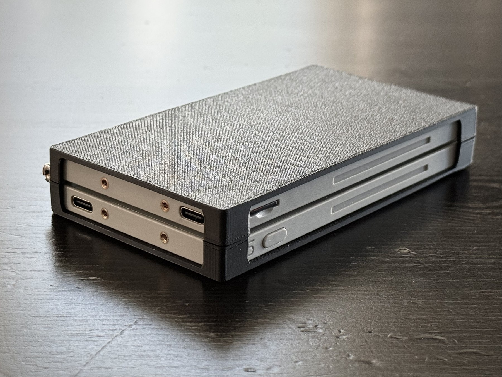
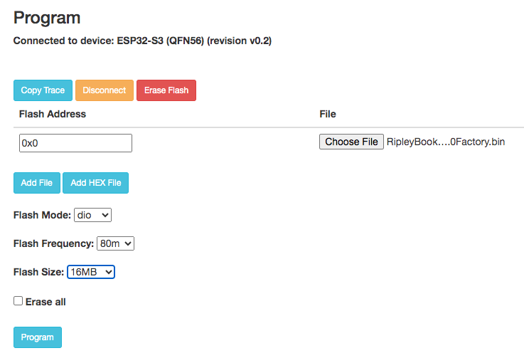
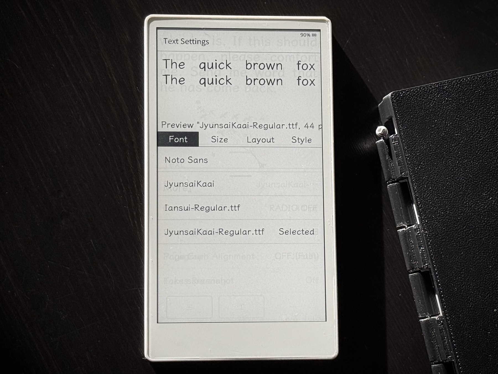
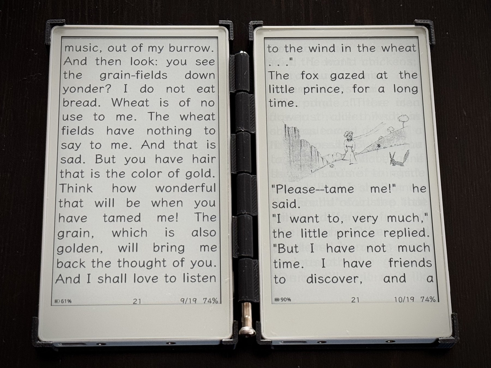
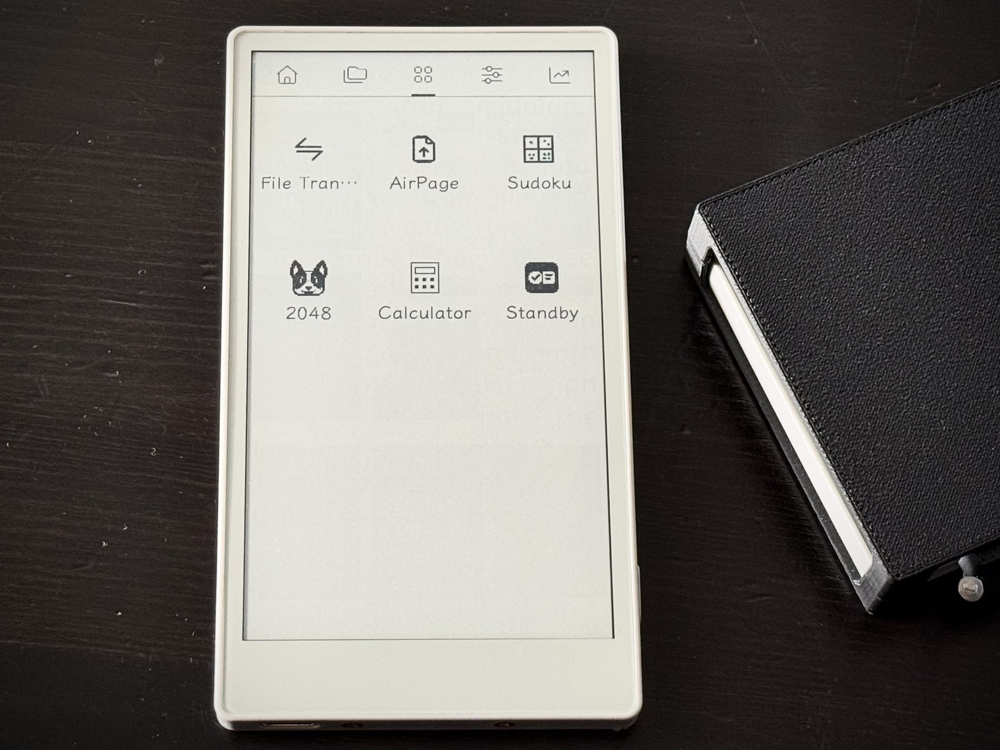
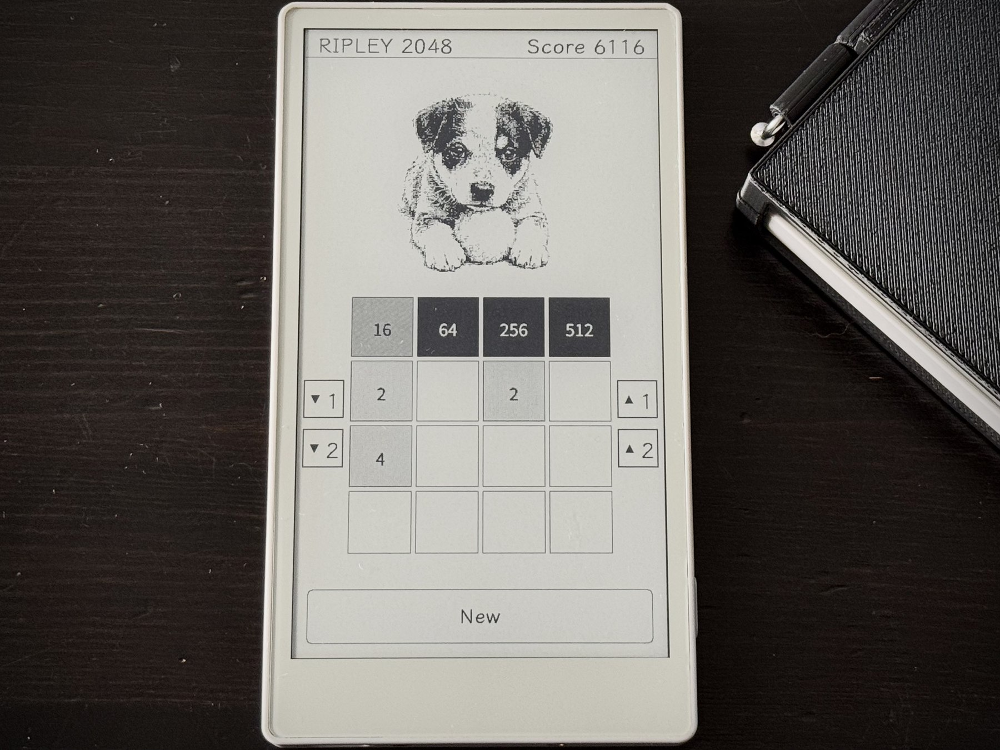

# RipleyBookDual 3.0

**Two E-Ink readers. One book opened across both screens—or two books moving forward side by side.**

[繁體中文](README.zh-TW.md) · **English**

RipleyBookDual 3.0 is an EPUB reader firmware for the **M5Stack Paper S3**. There is **one Full edition**: enjoy a standalone reader with freely selectable TTF fonts, or install the **same firmware on two devices** to link them directly over ESP-NOW, without a Wi-Fi router. **Spread feels like opening a real book**; when two language editions have corresponding main-text chapters, **Parallel 3.0 makes an excellent bilingual reading setup**.



*Two Paper S3 readers can sit together like an open book—and close like one, too.*

## Contents

- [Features and reading modes](#features-and-reading-modes)
- [What you need](#what-you-need)
- [Step 1: Install the Factory firmware](#step-1-install-the-factory-firmware) (advanced manual method is inside an expandable section)
- [Step 2: Read EPUBs and choose fonts](#step-2-read-epubs-and-choose-fonts)
- [Step 3: Pair two readers](#step-3-pair-two-readers)
- [Spread: one book, two facing pages](#spread-one-book-two-facing-pages)
- [Parallel 3.0: two books together](#parallel-30-two-books-together)
- [Apps and custom Ripley games](#apps-and-custom-ripley-games)
- [Updates and troubleshooting](#updates-and-troubleshooting)
- [Firmware integrity and acknowledgments](#firmware-integrity-and-acknowledgments)

## Features and reading modes

| Mode | Devices | How it works |
| --- | --- | --- |
| **Solo** | One | A full EPUB reader with freely selectable TTF fonts, adjustable type size, chapter selection and saved reading position |
| **Spread** | Two, same book | Facing pages with coordinated page turns, chapters and sleep/wake |
| **Parallel 3.0** | Two books with corresponding main-text chapters | Ideal for bilingual original/translation reading; each book retains its own layout |

**Both readers install the identical RipleyBookDual 3.0 Full firmware.** There is no special RIGHT or LEFT BIN. Owners of only one Paper S3 can use it normally without pairing.

## What you need

- **Hardware:** M5Stack Paper S3, a microSD card and a **data-capable USB-C cable**. Other Paper models and ESP32 boards are not supported.
- **Initial USB installation:** desktop **Chrome or Edge** with Web Serial support.
- **Books:** your own EPUB files and any desired fonts on microSD. Books and commercial fonts are **not included** in the firmware.
- **Dual reading:** two Paper S3 readers, each with a microSD card. ESP-NOW pairing does not need home Wi-Fi.
- **3.0 Full Factory BIN:** [RipleyBookDual3.0-Full-Factory.bin](docs/firmware/RipleyBookDual3.0-Full-Factory.bin) (6,333,440 bytes; installation verified on a real Paper S3).
- **Corresponding source and checksums:** Download the complete Source ZIP from [RipleyBookDual-p-Source Releases](https://github.com/2d-ripley/RipleyBookDual-p-Source/releases).

| Firmware | Purpose | Installation |
| --- | --- | --- |
| **Factory BIN** (hardware-tested) | First-time setup, recovery or complete USB flashing | **RipleyBookDual one-click installer** (recommended); Espressif's manual ESP Tool is the advanced fallback, using offset `0x0` |
| **SD Update BIN** (future releases) | Update the application on an already working device | On-device **System → SD Firmware Update** |

**Never use the Factory BIN for SD Firmware Update or flash an application-only BIN at `0x0`.** Renaming the file does not change its format.

## Step 1: Install the Factory firmware

1. **Back up anything important.** Factory flashing may erase existing settings and data stored in flash. Keep copies of reading positions and microSD data.
2. Connect the Paper S3 using a **USB-C data cable**. On a computer with Chrome or Edge, open the [RipleyBookDual 3.0 one-click installer](https://2d-ripley.github.io/RipleyBook-DualS3-Flasher/?lang=en).
3. Enter the Paper S3 download mode: **hold the power button until the rear status LED flashes red, then release**.
4. Only one choice appears: **RipleyBookDual 3.0 Full**. After firmware verification, select **Install**, choose the correct serial port and confirm flashing.
5. Keep the USB cable connected and do not run other serial tools. When installation finishes, reboot and confirm that Home and Reader launch.
6. If you have two readers, repeat with the **exact same firmware version** on the second Paper S3.

**One-click USB installation was verified on a real Paper S3 on November 13, 2026** ✅. The installer checks the Factory BIN length, ESP32-S3 image structure and full SHA-256 before enabling installation.

<details>
<summary><strong>Advanced / fallback method: manual flashing with Espressif ESP Tool (expand)</strong></summary>

If the one-click installer is unavailable, use [Espressif's official ESP Tool](https://espressif.github.io/esptool-js/) with the **complete Factory BIN** at flash address **`0x0`**. **The screenshot below shows the manual ESP Tool, not RipleyBookDual's one-click installer.**



*Hardware-tested manual settings: Flash Address `0x0`, Mode `DIO`, Frequency `80 MHz`, Flash Size `16 MB`. The screenshot has “Erase all” unchecked. Do not use an SD Update BIN here.*

</details>

## Step 2: Read EPUBs and choose fonts

**Reading normally:** Copy EPUBs to microSD. Open a book from **Files** the first time; afterward it can be selected directly from **Home**. Tap the **centre of the Reader screen** to open the menu. Use **Contents** for chapters, **Text** for font face/size and **More** for connection, reading mode and screenshots.

**Recommended interface:** In **Settings → Display**, choose **Inx** for **UI Theme** and **Icons** for **Inx Apps Layout**.

**Choose your own font:** Reader can use TTF fonts from the microSD card's `fonts/` directory, including **JyunsaiKaai-Regular / 44 pt** as the recommended default. Extremely large TTF files can increase load time and memory use; choose one that covers your book's characters without being unnecessarily huge. This concerns the font file's storage size, not the displayed point size. System UI fonts are configured separately under **System / Settings** and can use compatible TTF / `.cpfont` files. The Factory BIN does **not** include font files.



*The Text menu lets you select TTF fonts and adjust the reading size.*

### SD card font and folder setup

**Strongly recommended — SD Starter Kit:** Download the [SD Starter font and folder ZIP](https://github.com/2d-ripley/RipleyBook-DualS3-Flasher/releases/download/sd-starter-v1/RipleyBookDual3.0-SD-Starter.zip), extract it, and place its **`books/` and `fonts/`** directories at the **microSD card root**. Alternatively, [download JyunsaiKaai-Regular.ttf from the font author](https://raw.githubusercontent.com/ItMarki/jyunsaikaai/9e35c8713517762c36c84cdb5a9a9a0bdfec57b8/fonts/JyunsaiKaai-Regular.ttf) and make `fonts/` yourself.

```text
microSD card/
├── books/                      ← Optional: your EPUBs
│   └── YourBook.epub
└── fonts/                      ← Reader's TTF lookup folder
    └── JyunsaiKaai-Regular.ttf
```

`books/` is just a convenient folder name; Reader expects the font at **`fonts/JyunsaiKaai-Regular.ttf`**. In the Reader **Text** menu, select this font at **44 pt**. If your card already contains reading history, **merge folders instead of overwriting the entire card**.

**JyunsaiKaai font:** Thanks to [ItMarki](https://github.com/ItMarki/jyunsaikaai) for this beautiful typeface. Using the SD Starter Kit is the easiest way to get started.

**Reading positions:** Normal exits preserve the latest position. After a linked session, the updated positions should be kept rather than reverting to those from before pairing.

**EPUB compatibility:** There is **no arbitrary maximum file size in MB**. Indexing performance and memory usage depend more on **individual HTML/XHTML chapter length, image sizes, embedded fonts, CSS complexity and EPUB structure**. Image-heavy or unusually complex books can be slow or exceed available memory.

## Step 3: Pair two readers

### Before pairing: check the books and layout

**For Spread, match the font and font size on both readers.** For example, use the same `JyunsaiKaai-Regular.ttf` file at **44 pt**, with corresponding margins and line spacing. If using a custom TTF, copy the **identical file** onto both cards. **In Parallel, each book can use a different font, point size and layout.**

**Spread also requires the exact same EPUB file from the same source.** Matching titles or different editions of the same work do not guarantee compatible pagination. **Easiest method:** copy microSD contents when first preparing two fresh devices. Once they have separate reading histories, do **not** overwrite one entire card with the other; copy only the EPUB/font files needed.

**Parallel 3.0 can use two different EPUBs**, such as the original and its translation. Their pagination and absolute chapter numbering need not match.

Place the readers side by side, each with a book open:

1. **RIGHT (leader):** Tap the page centre → **More → Connection → Connect RIGHT (Leader)**.
2. **LEFT (follower):** Tap the page centre → **More → Connection → Connect LEFT (Follower)**.
3. When paired, **RIGHT selects Reading Mode**: Spread or Parallel.
4. Use **Reconnect Last Device** to reconnect when appropriate, or **Disconnect DualS3** for a deliberate disconnect.

RIGHT and LEFT are roles chosen **inside Reader**, not separate firmware images. Manual disconnection should not trigger a hidden automatic rejoin; normal sleep/wake recovery is supported separately.

## Spread: one book, two facing pages

**Spread is RipleyBookDual's signature experience:** two Paper S3 screens behave like facing pages of the same book, with even pages on LEFT, odd pages on RIGHT and page turns moving across both screens.

[](https://2d-ripley.github.io/RipleyBook-DualS3-Flasher/watch.html?v=spread-en)

1. Confirm the **same EPUB, font and font size** on both devices before pairing.
2. On **RIGHT**, choose **More → Reading Mode → Spread (Current Book)**.
3. Linked Spread displays even pages on **LEFT** and odd pages on **RIGHT**. Turn forward from RIGHT to advance one spread (**+2 pages**).
4. Use the **outer edge of LEFT** to go back one spread (**−2 pages**). Optional **More → Page Curl → On** creates a larger lower-right curling-page effect, starting with the forward tap and disappearing after RIGHT refreshes. It is **Spread-only**, default **Off (Fast)**.
5. A chapter selection from **Contents** aligns LEFT with the selected chapter's **first page** before resuming two-page reading.
6. Swipe up to **Home on RIGHT** to return both readers Home, disconnect, clear temporary pairing state and preserve progress.

**English video demo:** [▶ Watch on the web: Spread pairing, page turns and chapter controls](https://2d-ripley.github.io/RipleyBook-DualS3-Flasher/watch.html?v=spread-en). · [Original MP4 (download)](https://github.com/2d-ripley/RipleyBook-DualS3-Flasher/raw/refs/heads/main/docs/media/spread-en.mp4)

**Video playback:** Select an image or web-player link to watch the demo. If your browser cannot play it, use the original MP4 download link instead.

Spread also supports linked sleep/wake recovery, including preventing an idle-looking LEFT reader from unexpectedly falling out of the session during active reading.

## Parallel 3.0: two books together

**Ideal for bilingual reading:** Put the original and translation side by side when their **main-text chapter sequences broadly correspond**. The books can have different fonts, layouts, text lengths and page counts. They **join in place**, from the passages you chose independently; the system uses relative chapter offsets **±N** rather than sentence-level or paragraph-level alignment.

[](https://2d-ripley.github.io/RipleyBook-DualS3-Flasher/watch.html?v=parallel-en)

**Important:** Before linking, open **both books at corresponding passages within the main text**. Avoid forewords, introductions, tables of contents, afterwords, author notes, acknowledgments and appendices. Edition-specific extras can shift the relative chapter sequence; the firmware does not automatically skip them.

1. **Open both EPUBs and move each book to a corresponding position in the main text before pairing.** You do not need to return to chapter beginnings.
2. On RIGHT select **More → Reading Mode → Parallel**. Accept **Join** on LEFT.
3. **RIGHT controls the shared page-turning pace.** LEFT progresses through **its own book** and may be adjusted manually as needed.
4. When RIGHT crosses a chapter boundary, LEFT advances to the corresponding chapter. If LEFT finishes first, it **waits at the end of its chapter**.
5. When RIGHT chooses a **specific chapter** in **Contents**, the firmware computes its relative main-chapter difference **±N**; LEFT follows to the **corresponding chapter** in its own book. For example: RIGHT goes from chapter 9 to 12 (+3), while LEFT goes from chapter 1 to 4 (+3). Chapter titles and absolute numbers are **not** matched.
6. If the main-text chapter anchors cannot be resolved reliably, the firmware **declines the jump** instead of guessing. The large page curl is not used in Parallel.

**English video demo:** [▶ Watch on the web: Parallel pairing, independent adjustment and chapter selection](https://2d-ripley.github.io/RipleyBook-DualS3-Flasher/watch.html?v=parallel-en). · [Original MP4 (download)](https://github.com/2d-ripley/RipleyBook-DualS3-Flasher/raw/refs/heads/main/docs/media/parallel-en.mp4)

Parallel supports sleep/wake reconnection and retains each book's own reading position when leaving the session. **Unlike Spread's dual-Home exit, the other reader may stay in its own reading view.**

> **Limitation:** Relative ±N chapter movement does not understand translation semantics. You may need to adjust starting positions if editions divide chapters differently.

## Apps and custom Ripley games

Open **Apps** from Home. Other utilities include **File Transfer, OPDS Browser, AirPage, Reading Stats, Chinese Chess, Calculator and Standby**, depending on visibility settings and available services.



### Ripley 2048

Open **Apps → 2048**, identified by its **monochrome dog-head icon**.



- **Swipe up, down, left or right** to move tiles. Matching values merge; aim for 2048 and beyond.
- Enjoy custom grayscale tiles, score tracking and **different Ripley illustrations as you reach milestones**—with a few small surprises along the way!
- The **two slots on the left** are **Save 1 / Save 2**; the **two on the right** are **Load 1 / Load 2**. Occupied save slots have bolder outlines.
- Regular progress is auto-saved, so a new session can pick up where you left off.
- **New** starts a fresh game, with confirmation when needed.

🐾 **A small request about Ripley's illustrations:** These eight drawings were made with care for RipleyBookDual. We love sharing our work, and we hope you'll treat the art with the same respect. Please don't treat it as anonymous clip art, casually lift it into unrelated projects, erase its origins, or pass it off as your own. **Sharing starts with generosity; it lasts with mutual respect.**

### Ripley Sudoku

Open **Apps → Sudoku** to pick a difficulty or continue an unfinished puzzle. It includes custom handwritten-style digits, board layout and Ripley win/lose artwork.

- Select a cell, then **tap 1–9** to fill it. **X** erases an entry; fixed clues cannot be changed.
- **Game Menu → Toggle Notes** enables candidate-number notes.
- **Use Hint** offers up to **3 hints per puzzle**. **Check Errors** checks mistakes; there is a **3-mistake limit**.
- **Restart** restarts the same puzzle, **New Game** starts another and **Exit** saves the state and leaves.

## Updates and troubleshooting

**Updating from an installed Reader:** Use **System → SD Firmware Update** **only** with a dedicated **application-only SD Update BIN**. The Flasher's complete USB Factory BIN is **not** interchangeable with an SD Update image.

**USB serial port missing?** Check the USB-C data cable, close other serial applications, use desktop Chrome/Edge and enter the official Paper S3 download mode again.

**Pairing fails or Spread pages are misaligned?** Check identical firmware, correct RIGHT/LEFT roles and matching fonts/layouts. Spread requires **exactly the same EPUB** on both SD cards. Parallel can use different EPUBs. Try **Reconnect Last Device** or pair afresh.

**Chapter jumps do not agree?** Let both displays finish updating in Spread. In Parallel, chapter order or anchors may be too different for a reliable relative mapping.

**Indexing is slow or memory is tight?** Test a simpler text-oriented EPUB. Compressed file size alone does not tell the whole story.

**Factory recovery:** Keep a known-good Factory BIN, use the Paper S3 official download-mode procedure, and never flash an incompatible BIN.

## Firmware integrity and acknowledgments

**Single 3.0 Full Factory image (hardware-tested):** [RipleyBookDual3.0-Full-Factory.bin](docs/firmware/RipleyBookDual3.0-Full-Factory.bin)  
**Hardware:** M5Stack Paper S3 / ESP32-S3, 16 MB flash  
**Factory flash offset:** `0x0`  
**File size:** 6,333,440 bytes  
**Factory SHA-256:** `36da144dd3d8c4ce4fc33a3e8ff2db60bed4738312e5ed15794ba475ec1f16b1`

The digest refers to the **complete Factory image**, not an application-only SD Update BIN. The firmware reports **RipleyBookDual / 3.0 Full**. Its embedded application SHA-256 is `c0a46ccb4f777487bdfc4b94321cbe8f5683145587a24cd6f7a4801641b14838`. **One-click USB installation passed its Paper S3 hardware test on November 13, 2026.**

Thanks to the authors and communities of [CrossPoint Reader](https://github.com/crosspoint-reader/crosspoint-reader), [CrossMux](https://github.com/0x1abin/crossmux) and [FreeInk SDK](https://github.com/0x1abin/freeink-sdk). RipleyBookDual 3.0 is an **unofficial personal derivative**, not an official release by M5Stack or those projects.


References: [M5Stack Paper S3 download mode](https://docs.m5stack.com/en/core/PaperS3) · [ESP Web Tools](https://esphome.github.io/esp-web-tools/)

---

*RipleyBookDual 3.0 — One Full firmware. One reader, or two.*