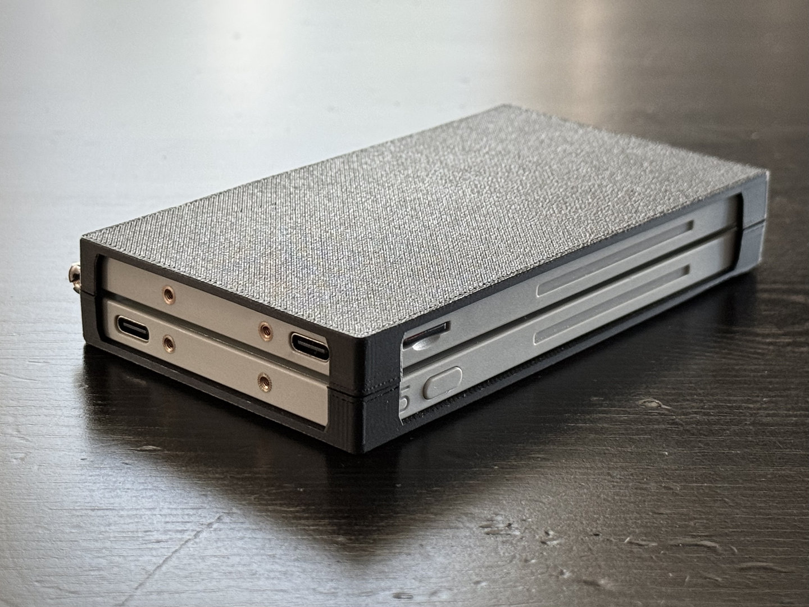
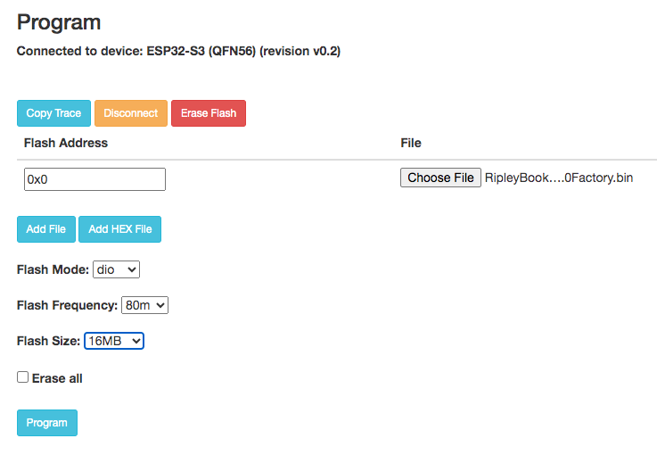
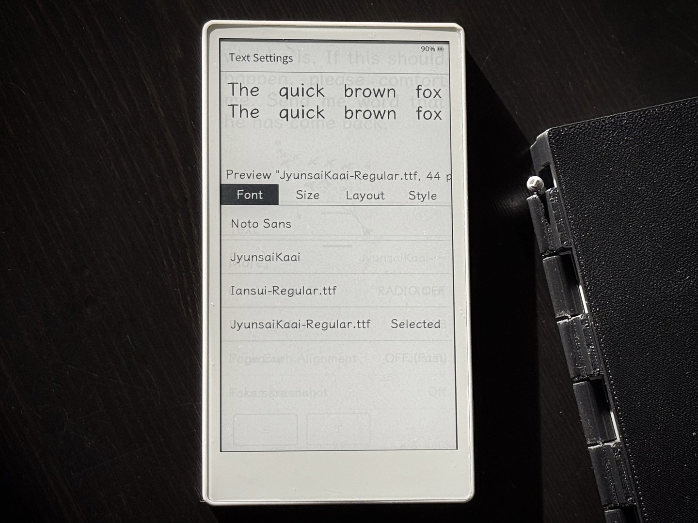
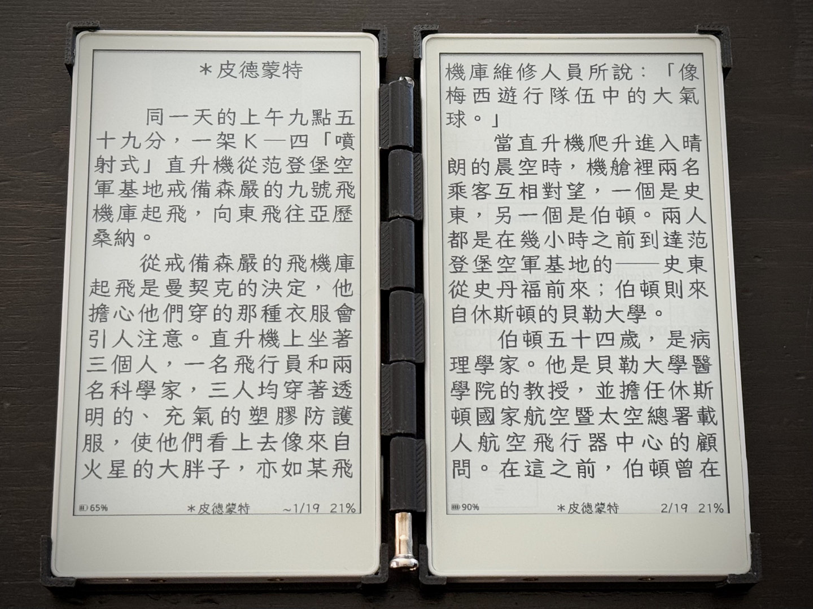
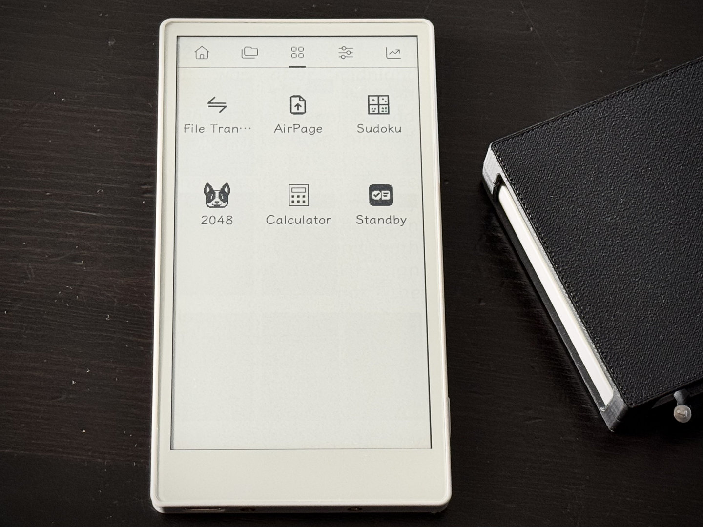
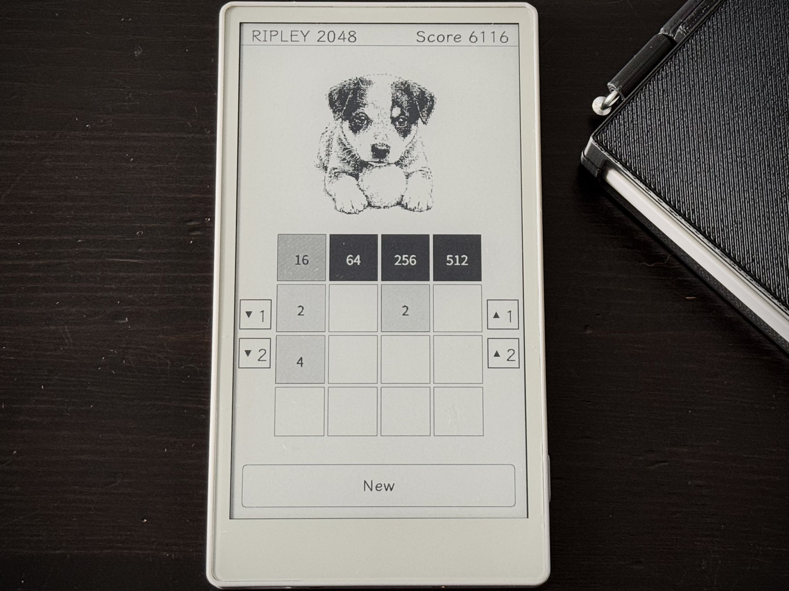

# RipleyBookDual 3.0

**兩台 E-Ink 閱讀器，一本攤開的書；也可以各讀一本，並肩前進。**

**繁體中文** · [English](README.md)

RipleyBookDual 3.0 是專為 **M5Stack Paper S3** 製作的 EPUB 閱讀韌體。**只提供一個 Full 版本**：一台可以自由選用喜愛的 TTF 字型閱讀；兩台安裝**相同韌體**，就能以 ESP-NOW 直接連動，不需要 Wi-Fi 路由器。**Spread 像攤開一本真正的書**；有正文結構對應的兩個語言版本時，**Parallel 3.0 更適合雙語對照閱讀**。



*兩台 Paper S3 並排使用；闔上時也像一本小書。*

## 導覽

- [特色與模式](#特色與模式)
- [硬體需求與安裝方式](#硬體需求與安裝方式)
- [第一步：安裝 Factory 韌體](#第一步安裝-factory-韌體)（進階手動刷機在該節底下展開）
- [第二步：開書與設定字型](#第二步開書與設定字型)
- [第三步：雙機配對](#第三步雙機配對)
- [Spread：一本書、左右兩頁](#spread一本書左右兩頁)
- [Parallel 3.0：兩本書同步](#parallel-30兩本書同步)
- [Apps 與自製遊戲](#apps-與自製遊戲)
- [更新、備份與疑難排解](#更新備份與疑難排解)
- [韌體驗證與致謝](#韌體驗證與致謝)

## 特色與模式

| 模式 | 一台／兩台 | 閱讀方式 |
| --- | --- | --- |
| **Solo** | 一台 | 完整 EPUB 閱讀器，自由選用 TTF 字型、調整字號、選章與保存進度 |
| **Spread** | 兩台、同一本書 | 左右兩頁像真正攤開一本書；跨頁翻動、章節與休眠連動 |
| **Parallel 3.0** | 兩個正文結構對應的版本 | 推薦原文＋譯本雙語閱讀；各自排版，右機帶動章節與翻頁 |

兩台都使用**相同的 RipleyBookDual 3.0 Full 韌體**，沒有另外的左機／右機 BIN。使用單機的人也可以安裝，無須配對。

## 硬體需求與安裝方式

- **硬體：M5Stack Paper S3**，具備 USB-C、microSD 與可傳輸資料的 USB-C 線。**不適用**其他 Paper 系列或其他 ESP32 裝置。
- **首次 USB 刷機**：使用電腦版 **Chrome 或 Edge** 等支援 Web Serial 的瀏覽器。
- **放書**：將自己的 EPUB 與所需字型放到 microSD 卡；書籍和商用字型**不包含**在韌體中。
- **雙機**：準備兩台 Paper S3，各自放入 microSD 卡；ESP-NOW 連動不需要家庭 Wi-Fi。
- **3.0 Full Factory BIN**：[RipleyBookDual3.0-Full-Factory.bin](docs/firmware/RipleyBookDual3.0-Full-Factory.bin)（6,333,440 bytes；已通過實機刷機驗收）。
- **對應原始碼**：[RipleyBookDual-p-Source](https://github.com/2d-ripley/RipleyBookDual-p-Source/releases) 提供完整 Source ZIP 與 SHA-256。

| 韌體檔案 | 用途 | 安裝方式 |
| --- | --- | --- |
| **Factory BIN**（已通過實機驗收） | 首次安裝、故障救援、完整 USB 刷機 | **RipleyBookDual 一鍵刷機頁**（首選）；官方 ESP Tool 為進階備用，**起始位址 `0x0`** |
| **SD Update BIN**（後續升級用） | 系統已能運作時更新應用程式 | 機內 **System → SD Firmware Update** |

**絕對不要**把 Factory BIN 當 SD Update 使用，也不要將應用程式 BIN 寫在 `0x0`。改檔名不會改變韌體格式。

## 第一步：安裝 Factory 韌體

1. **先備份。** 首次刷機可能清除原有設定與 Flash 中的閱讀資料；先保存原本可用的韌體、重要進度及 SD 卡內容。
2. 以**可傳輸資料**的 USB-C 線連接 Paper S3 和電腦。在電腦的 Chrome／Edge 開啟 [RipleyBookDual 3.0 一鍵刷機頁](https://2d-ripley.github.io/RipleyBook-DualS3-Flasher/)。
3. 依 M5Stack 的下載模式流程：**長按 Paper S3 電源鍵，直到背面紅色狀態燈開始閃爍，再鬆開。**
4. 網頁只顯示 **RipleyBookDual 3.0 Full** 一種版本。看到刷機檔已驗證後，點 **Install／安裝**，選擇正確序列埠並確認刷入。
5. 寫入過程中**不要拔線**或讓其他程式占用序列埠。完成後按裝置提示重新啟動，確認可以進入 Home／Reader。
6. 若有第二台 Paper S3，對它**重複相同步驟**，兩台安裝完全相同版本。

**一鍵刷機已通過實機驗收 ✅**（2026-11-13，在 Paper S3 上成功安裝）。安裝程式會先檢查完整 BIN 的大小、ESP32-S3 Factory 結構和 SHA-256；檔案不符就不會啟用安裝按鈕。

<details>
<summary><strong>進階／備用方案：Espressif 官方 ESP Tool 手動刷機（點擊展開）</strong></summary>

如果一鍵安裝無法使用，可改用 [Espressif 官方 ESP Tool](https://espressif.github.io/esptool-js/)。先下載**完整 Factory BIN**，在工具內選擇 BIN，寫入位址使用 **`0x0`**。這是備用方案，**下圖不是 RipleyBookDual 的一鍵刷機畫面**。



*已通過實機測試的手動設定：Flash Address `0x0`、Mode `DIO`、Frequency `80 MHz`、Flash Size `16 MB`，圖片中「Erase all」未勾選。請勿將 SD Update BIN 當成 Factory BIN 刷入。*

</details>

## 第二步：開書與設定字型

**一般閱讀**：將 EPUB 放入 microSD 卡，首次透過 **Files** 開啟書籍，之後即可直接從 **Home** 選擇已開啟過的書籍。在 Reader 中點選畫面中央叫出選單。**Contents** 用於選章節，**Text** 設定字型與文字大小，**More** 提供連線、閱讀模式與 Screenshot 等項目。

**介面建議**：在 **Settings → Display** 將 **UI Theme** 設為 **Inx**、**Inx Apps Layout** 設為 **Icons**。

**自由選字**：Reader 可從 SD 卡的 `fonts/` 自由選用自己喜歡的 **TTF 字型**，不必侷限於內建字體；預設閱讀設定為 **JyunsaiKaai-Regular／44 pt**。**建議不要使用容量過大的 TTF 字型檔**：大型字庫可能增加載入時間與記憶體負擔。選擇檔案大小適中、且涵蓋書籍所需字元的字型即可，沒有硬性的 MB 上限。這裡指的是**字型檔容量**，不是畫面上的字號。系統介面字型則可在 **System／Settings** 另外設定，支援相容的 TTF／`.cpfont`。**Factory BIN 不附帶字型檔**；可使用下方免費字型包準備 SD 卡。



*Reader 的 Text 設定可切換 TTF 字型與文字大小。*

### SD 卡字型與資料夾

**強力推薦先使用 SD Starter Kit（最省事）**：直接下載 [SD Starter 字型與資料夾套件](https://github.com/2d-ripley/RipleyBook-DualS3-Flasher/releases/download/sd-starter-v1/RipleyBookDual3.0-SD-Starter.zip)，解壓後將**裡面的 `books/`、`fonts/`** 放到 microSD 卡**根目錄**。或 [直接從原作者下載 JyunsaiKaai-Regular.ttf](https://raw.githubusercontent.com/ItMarki/jyunsaikaai/9e35c8713517762c36c84cdb5a9a9a0bdfec57b8/fonts/JyunsaiKaai-Regular.ttf)，自行建立 `fonts` 資料夾。

```text
microSD 卡/
├── books/                      ← 自建；可改名，放 EPUB
│   └── 你的書.epub
└── fonts/                      ← Reader 會搜尋此目錄
    └── JyunsaiKaai-Regular.ttf
```

`books/` 只是方便管理書籍的建議名稱；**`fonts/JyunsaiKaai-Regular.ttf` 必須位於這個相對路徑**。在 Reader 的 **Text** 選擇該字型與 **44 pt**。若 SD 卡已存有閱讀進度，請合併資料夾，**不要直接整卡覆蓋**。

**JyunsaiKaai 字型**：感謝 [ItMarki](https://github.com/ItMarki/jyunsaikaai) 的作品；建議直接使用本專案提供的 SD Starter Kit。

**閱讀進度**：正常離開閱讀器時保留最新位置。雙機連線後退出也應保存連動後的新進度，而非回跳到配對前的位置。

**EPUB 相容性**：沒有任意設定的「幾 MB 以上不能讀」上限。真正影響索引與記憶體的，往往是**單章 HTML／XHTML 的長度、圖片尺寸、內嵌字型、CSS 複雜度**及書籍結構。圖片很多或章節異常複雜的 EPUB 可能索引較慢，甚至超過可用記憶體。

## 第三步：雙機配對

### 配對前：先核對書籍與排版

**Spread 模式請先將兩台 Reader 設成相同的字型與字號。** 例如兩台都選擇相同的 `JyunsaiKaai-Regular.ttf`、**44 pt**；若使用自訂 TTF，應把**同一份字型檔**複製到兩張 SD 卡。行距、頁邊距等排版設定也盡量一致，避免兩台分頁不同。**Parallel 3.0 則可各自使用不同的字型、字號與排版。**

**Spread 還要求兩台使用同一來源、同一份 EPUB 檔案**。同書名、同作者，甚至同一作品不同出版商的版本都不等於相同檔案，可能因章節、排版或內容差異而無法正確同步。**最省事：初次準備時直接複製 SD 卡內容**，確保兩機使用完全相同的 EPUB 與 TTF。若兩台已分別開始閱讀，**不要再整卡互相覆蓋**，以免蓋掉各自的閱讀進度或儲存資料；只複製需要同步的 EPUB／字型檔即可。

**Parallel 3.0 可使用不同 EPUB（例如原文和譯本）**，不要求兩本書檔案相同；各自採用自己的排版與字型設定，不需要頁碼、字數或兩邊章節起點相同。

將兩台 Paper S3 放在左、右位置，各自開啟 EPUB，然後：

1. **右機（主控）**：點畫面中央 → **More → Connection → Connect RIGHT (Leader)**。
2. **左機（跟隨）**：點畫面中央 → **More → Connection → Connect LEFT (Follower)**。
3. 配對完成後，由**右機選擇 Reading Mode**：Spread 或 Parallel。
4. 再次使用時可嘗試 **Reconnect Last Device**。需要結束連線則選 **Disconnect DualS3**。

兩台角色不是靠刷不同韌體決定，而是在 Reader 中選擇。手動 Disconnect 後不應自動偷偷重連；睡眠／喚醒的恢復則屬於正常連線功能。

## Spread：一本書、左右兩頁

**Spread 是 RipleyBookDual 的核心體驗**：把兩台 Paper S3 像書頁並排，左偶右奇、一次翻動一個跨頁，閱讀感受就像真正攤開一本書。

[](https://2d-ripley.github.io/RipleyBook-DualS3-Flasher/watch.html?v=spread-zh)

1. 檢查兩台都使用**同一來源、完全相同的 EPUB 檔**，且 Reader 的**字型、字號相同**；建議在首次使用前直接複製 SD 卡內容備妥兩機，再完成上面的配對。
2. 在**右機**打開該書，選 **More → Reading Mode → Spread (Current Book)**。
3. 連動成功時，**左機顯示偶數頁，右機顯示奇數頁**。右機向前翻一個跨頁會以 **+2 頁**前進。
4. 在**左機外側**操作可往回一個跨頁（**−2 頁**）。右機 **More → Page Curl → On** 可開啟大捲角：向前點翻頁時立即捲起，右機完成頁面更新後才攤平；此效果**僅限 Spread**，預設 Off (Fast)。
5. 由 **Contents** 切換章節時，左機會對齊該章**第一頁**；兩台再以跨頁方式閱讀。
6. 右機上滑回 **Home**，兩機應一起回 Home、解除連線與清理暫存，並保存最新閱讀進度。

**影片示範（繁中）**：[▶ 網頁播放器：Spread 的配對、翻頁與章節操作](https://2d-ripley.github.io/RipleyBook-DualS3-Flasher/watch.html?v=spread-zh) · [原始 MP4（下載）](https://github.com/2d-ripley/RipleyBook-DualS3-Flasher/raw/refs/heads/main/docs/media/spread-zh.mp4)

**影片播放說明：** 點選圖片或「網頁播放器」可觀看示範影片；若瀏覽器無法播放，也可使用「原始 MP4」連結直接下載。

Spread 也支援睡眠／喚醒後重新配對恢復，不會因左機較少被觸碰就任意讓它脫離連動。

## Parallel 3.0：兩本書同步

**特別推薦雙語閱讀**：如果有同一作品的原文與譯本，而且兩本書的**正文順序、章節劃分大致對應**，Parallel 3.0 就很適合放在左右兩機並排對照。兩本書的字型、排版、字數與實際頁數可以不同。**連線採原地對應**：各自在自己選定的章節開始，不強制跳回章首或對齊絕對章號；跨章依相對章節差 ±N 前進，不會自動對齊句子或段落。

[](https://2d-ripley.github.io/RipleyBook-DualS3-Flasher/watch.html?v=parallel-zh)

**連線位置很重要：Parallel 只建議在兩本書的正文（故事主體）內開始連線。** 請先讓左右機各自進入彼此對應的正文段落，避開序言、前言、導讀、推薦序、目錄、後記、作者感言、致謝、附錄等非正文內容。不同版本的附加篇章可能數量或順序不一，容易使相對章節 ±N 對應失準；系統不會自動判斷並略過這些內容。

1. **兩台先各自開好自己的 EPUB，並分別進入對應的正文段落，再進行 RIGHT／LEFT 配對**；不必為了連線回到章首。
2. 右機選 **More → Reading Mode → Parallel**，左機在提示視窗按 **Join**。
3. **右機掌握翻頁節奏**，左機在**自己的書**中前進。必要時左機可手動微調位置。
4. 右機翻過章節邊界時，左機依對應章節前進；若左機先讀完當章，則**留在章末等待**。
5. 右機從 **Contents** 選擇章節時，系統計算相對於右機目前正文位置的**章節差 ±N**，讓左機在自己的 EPUB 中前進或後退**相同 ±N 個正文章節**。例如右機第 9 章、左機第 1 章，右機選第 12 章（+3）後，左機會選自己的第 4 章。**不比較章節標題，也不套用右機的絕對章號或頁碼**。
6. 若 EPUB 目錄結構無法可靠判定正文章節、章節錨點有歧義，系統會拒絕跳轉，避免跳錯位置。Parallel 不使用大捲角。

**影片示範（繁中）**：[▶ 網頁播放器：Parallel 的雙書同步、微調與選章操作](https://2d-ripley.github.io/RipleyBook-DualS3-Flasher/watch.html?v=parallel-zh) · [原始 MP4（下載）](https://github.com/2d-ripley/RipleyBook-DualS3-Flasher/raw/refs/heads/main/docs/media/parallel-zh.mp4)

Parallel 支援睡醒重連。結束連動時，各自的閱讀位置應保留；**Parallel 回 Home 的行為與 Spread「兩機一起回 Home」不同**，另一台可留在自己的閱讀畫面。

> **重要限制**：章節跳轉使用相對差值 ±N，並非自動理解兩本書的內容；若章節拆分方式不同，仍需自行調整起點。這不是逐句翻譯或段落自動對齊。

## Apps 與自製遊戲

從 Home 的 **Apps** 進入。除了閱讀器外，仍保留實用工具，例如 **File Transfer、OPDS Browser、AirPage、Reading Stats、Chinese Chess、Calculator、Standby**，及下面兩個 Ripley 自製版本。部分 App 可能依系統設定或是否有設定 OPDS 伺服器而顯示不同。



### Ripley 2048

入口：**Apps → 2048**。圖示是**黑白狗頭**。



- **上下左右滑動**方塊；相同數字碰在一起合併，目標是做出 2048。
- 使用自製黑白階方塊、分數與 Ripley 成長插畫。**闖關時還會逐漸遇見不同圖案，藏著一點小驚喜！**
- **左側 1／2** 是 **Save 1／Save 2**；**右側 1／2** 是 **Load 1／Load 2**，可保存兩組手動進度。已保存槽位的邊框較粗。
- 遊戲也會自動保存一般進度；退出再進可以接著玩。
- **New** 可重開新局，必要時會詢問確認。

🐾 **關於 Ripley 插畫的小小請求：** 這八張插畫是為 RipleyBookDual 用心創作的。我們樂於分享，也希望大家尊重原創：請別把它們當成無主圖片，隨手搬去不相干的作品，更不要抹去出處、冒稱自己的創作。**分享靠熱情，長久靠互相尊重。**

### Ripley Sudoku

入口：**Apps → Sudoku**。可選擇難度或繼續先前的棋局；使用 Ripley 手寫風格數字、專屬棋盤及完成／失敗畫面。

- **點格子後選 1–9** 填數字；**X** 擦除，題目給定數字不能修改。
- **Game Menu → Toggle Notes** 切換候選數字筆記。
- **Use Hint** 每局最多 **3 次**；**Check Errors** 用於檢查錯誤，填錯次數上限 **3 次**。
- **Restart** 重做原題，**New Game** 開另一局，**Exit** 退出並保留進度。

## 更新、備份與疑難排解

**日後更新**：只有在已有可運作的 Reader 系統、且取得**專門的 SD Update 應用程式 BIN** 時，才使用 **System → SD Firmware Update**。本公開 Flasher 提供的 Factory BIN 是為**USB 出廠刷機**製作，不能代替 SD Update。

**找不到 USB 序列埠**？換成確定能傳資料的 USB-C 線、關閉其他序列埠程式、確認用的是 Chrome／Edge、重新進入 Paper S3 下載模式。

**配對不成功或 Spread 頁面錯位？** 先核對兩台是**相同版本、相同 Reader 字型及字號**，RIGHT／LEFT 角色正確，原先連線已正確結束。**Spread 必須使用同一來源、完全相同的 EPUB 檔案**，不要只核對書名；Parallel 則可先各自開好不同的書。再試 **Reconnect Last Device** 或重新配對。

**選章節後不一致**？Spread 請確認選的是本書章節並等待兩機更新；Parallel 的兩本 EPUB 若章節順序不一致，可能無法可靠映射。

**索引很慢或記憶體不足**？先試較簡單的純文字 EPUB；影響通常不只是檔案 MB 大小。

**恢復或刷機失敗**？保留一份已知能啟動的 Factory BIN，依 M5Stack 官方下載模式重試。不要將不適用的 BIN 硬刷進裝置。

## 韌體驗證與致謝

**唯一 3.0 Full Factory 韌體（已通過實機驗收）**：[RipleyBookDual3.0-Full-Factory.bin](docs/firmware/RipleyBookDual3.0-Full-Factory.bin)  
**硬體**：M5Stack Paper S3／ESP32-S3，16 MB Flash  
**Factory 寫入位址**：`0x0`  
**大小**：6,333,440 bytes  
**Factory SHA-256**：`36da144dd3d8c4ce4fc33a3e8ff2db60bed4738312e5ed15794ba475ec1f16b1`（已校驗並完成實機 USB 刷入／開機驗收）

這是完整的 **Factory** 映像，**不是**機內 SD Update 使用的應用程式 BIN。正式版顯示 **RipleyBookDual／3.0 Full**，已完成實機刷入、開機與閱讀功能驗收。完整 Factory SHA-256 如上；其內嵌應用程式 SHA-256 為 `c0a46ccb4f777487bdfc4b94321cbe8f5683145587a24cd6f7a4801641b14838`。**一鍵 USB 安裝已於 2026-11-13 通過 Paper S3 實機測試。**

感謝 [CrossPoint Reader](https://github.com/crosspoint-reader/crosspoint-reader)、[CrossMux](https://github.com/0x1abin/crossmux) 與 [FreeInk SDK](https://github.com/0x1abin/freeink-sdk) 的作者及社群。RipleyBookDual 3.0 是在這些開源成果上製作的**非官方個人衍生版**，並非上述專案或 M5Stack 的官方產品。


參考：[Paper S3 官方下載模式](https://docs.m5stack.com/en/core/PaperS3) · [ESP Web Tools](https://esphome.github.io/esp-web-tools/)

---

*RipleyBookDual 3.0 — One Full firmware. One reader, or two.*